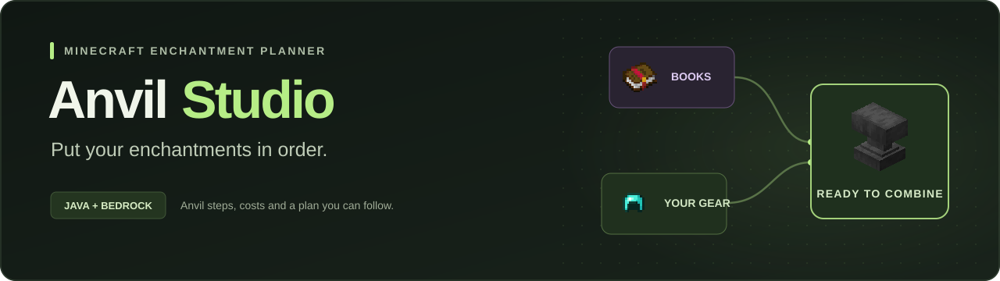

<p align="center">
  
</p>

<p align="center">
  
  
  
  <a href="LICENSE"></a>
</p>

<p align="center">
  <a href="https://anvil-studio.pages.dev/">Try it online</a> ·
  <a href="#using-the-planner">How to use it</a> ·
  <a href="#development">Development</a> ·
  <a href="#license">License</a>
</p>

Anvil Studio works out which enchanted books to combine and when to add them to
your gear. Pick the enchantments you want, then follow the steps to spend fewer
levels. There is also a graph if you want to see how everything comes together.

## Try it online

**[Open Anvil Studio](https://anvil-studio.pages.dev/)**

No installation needed. Choose your gear and enchantments, then select
**Show my steps** to calculate a plan.

## Using the planner

1. Choose your Minecraft edition, version and equipment.
2. Pick your enchantments and levels, or start with **Recommended**.
3. Select **Show my steps** and follow the order shown.

Keep the left and right anvil slots as shown; swapping them can change the cost.
Tick off steps as you go, switch to **View graph**, or export the plan as a text file.
On a smaller screen, the graph shows one combine at a time. Use the arrows to move
between steps, or choose **Full tree** to explore the whole plan.

## What it does

- Finds the cheapest order for your selected books, with each Survival step under 40 levels.
- Shows numbered steps with the left slot, right slot and result clearly labelled.
- Lets you switch to a graph, tick off completed steps and export your plan.
- Handles conflicting enchantments and selected historical compatibility rules.
- Offers recommended selections, search and settings for previous anvil work.
- Supports turtle shells, brushes and combining enchanted books into one book.
- Shares setups through links, including version, gear, enchantments and prior work.
- Offers optional original Minecraft sounds and a celebration when every step is done.
- Tracks finished steps with an XP-style bar and enchanting-table particles.
- Lists the books to gather, with a separate “Got it” checklist.
- Starts from existing item enchantments, including equal-level upgrades and edition-specific costs.
- Compares two builds, highlights changed enchantments and offers alternatives such as Silk Touch or Fortune.
- Offers an optional Resume button for the last plan and checked steps on this device.
- Shows themed item tooltips and downloads item cards with your theme, its mob and scenery.
- Includes five themes: Forest, Amethyst, Ocean, Ember and Overworld.
- Uses Minecraft item artwork, with separate mob scenes, fireflies, crystals, bubbles and embers.
- Animates the heading, selected count and plan totals, with a switch to turn motion off.
- Fades old plans away after edits and counts totals down when you reset.
- Uses quiet Minecraft sounds for panels, books, errors, reset and successful saves.
- Adapts to phones and tablets, with a readable graph for each step and an optional full tree.
- Remembers your theme and animation setting. Each visit starts with a fresh planner.

The search supports up to 13 distinct books. Advanced options let you optimise
for total levels, XP or the final prior-work penalty.

## Version profiles

| Edition | Versions                                                                      |
| ------- | ----------------------------------------------------------------------------- |
| Java    | 26.3, 1.21, 1.20, 1.14–1.14.2, 1.14.3 pre-release 1, 1.11.1, 1.11, 1.9–1.10.2 |
| Bedrock | 26.3, 1.21                                                                    |

Profiles apply the relevant item availability, book costs and compatibility
rules. Historical protection stacking and Mending/Infinity exceptions are handled
automatically. If you enable incompatible enchantments outside those exceptions,
the result is marked theoretical.

## Development

The site is plain HTML, CSS and JavaScript, with no build step. Python serves the
files for local testing; it is not part of the hosted website.

<details>
<summary>Run locally and host your own copy</summary>

You need Python 3 installed. Open a terminal in the project folder and run:

```sh
python serve.py
```

Open **http://127.0.0.1:8000** and keep the terminal running. Press **Ctrl+C** to stop.
If the port is busy, use `python serve.py --port 8001`.

On Windows, **Start Anvil Studio.bat** is an optional double-click shortcut.
Use the local server rather than opening `index.html` directly, because the app
uses JavaScript modules and a web worker.

### Hosting

Only **`dist/`** is needed on the live website. There is no build step.

For Cloudflare Pages, use **None** as the framework, leave the build command
empty and set the output directory to **`dist`**. These settings assume `dist`
is directly inside your repository. You can also upload the `dist` folder
through Direct Upload.

The Python server, Windows shortcut and tests are local development files;
Cloudflare does not need them in the published output.

</details>

## A few things to know

Start with your item and **one separate book per selected enchantment**,
already at the level you select. Untouched items and books have a prior-work
count of 0. If yours have been used on an anvil before, set their counts in
**More options**.

Use **Add** or **Edit** under **Already on this item** to set existing enchantments.
They appear as removable labels, leaving the main list for books you can still add.
The plan does not
include repairing durability, renaming items, or preparing higher-level books
from duplicate lower-level books.

**Wind Burst III:** combine four level-I books into two level-II books, then
combine those. Make that book first. The calculator accounts for its prior work,
but the displayed total excludes the levels spent making it.

**Levels and XP:** the XP option assumes you earn exactly the required levels
from level 0 before each step. Spending from an existing high-level XP bar costs
a different amount of XP.

Mods, plugins and custom data packs may change the rules.

## Editing the project

| Location                                                   | Purpose                                                  |
| ---------------------------------------------------------- | -------------------------------------------------------- |
| `dist/index.html`                                          | Page layout and help text                                |
| `dist/style.css`, `dist/responsive.css`, `dist/themes.css`, `dist/scenery.css` | Layouts, colours and animations                          |
| `dist/app.js`, `dist/plan-view.js`, `dist/stats.js` | Controls, results, graph, animated totals and export                      |
| `dist/data.js`, `dist/optimizer.js`                        | Version rules and calculation logic                      |
| `dist/assets/`                                             | Item images, mob images and credits                      |
| `scripts/`                                                 | Data and artwork download helpers, plus interface checks |
| `tests/`                                                   | Calculator regression tests                              |

Edit the files and refresh the local preview to see your changes.

The GitHub links are in **`dist/config.js`**. Change them if you host your own fork.

## Tests

Tests are optional for running the site, but useful when changing the calculator.
They check anvil costs, Survival limits, version rules and the calculated order
against an independent exhaustive search.

With Node.js 22 or newer:

```sh
node --test tests/*.test.js
```

For the interface checks:

```sh
npm ci
npm run test:ui
```

The test dependencies are only used during development. GitHub Actions runs both
sets of checks on pushes to `main` and on pull requests. These checks do not
replace checking the layout in a browser or comparing costs in-game.

## Found a wrong cost?

Open an issue with your edition, version, equipment, selected enchantments and
any previous anvil work. Include the cost shown in-game and the step where it
differs. This makes it much easier to reproduce the problem.

## License

The original code and documentation are available under the [MIT License](LICENSE).

Minecraft artwork and third-party assets are not relicensed under MIT.
See the [artwork credits](dist/assets/CREDITS.md) for their sources and notices.

## Credits

Enchantment data comes from the [version-pinned Minecraft data in mcmeta](https://github.com/misode/mcmeta/tree/26.3-data/data/minecraft/enchantment).

Anvil Studio is an unofficial fan project, not affiliated with Mojang or Microsoft.
Minecraft names and artwork belong to their respective owners.

---

Made by [Kieranmcm07](https://github.com/Kieranmcm07).
If this saves you a few levels, a star would be appreciated.

### Existing gear and saved progress

Open **Already on this item** and enter the enchantments your gear has now. The
main selection still represents the separate books you will add. For example,
Unbreaking II on your item plus an Unbreaking II book produces Unbreaking III.
Set the item's prior-work count in **More options** if it has been through an anvil.
This does not model repairs, renaming or combining two pieces of gear.

Calculated plans and checklist progress stay in this browser's local storage.
A new visit starts empty; choose **Resume** to restore the last plan. **Forget**
or **Reset** deletes it. Build A/B comparisons last for the current page session.
Share links include existing enchantments but not your checked steps or supplies.
Item cards describe the planned result until all steps are marked done.
